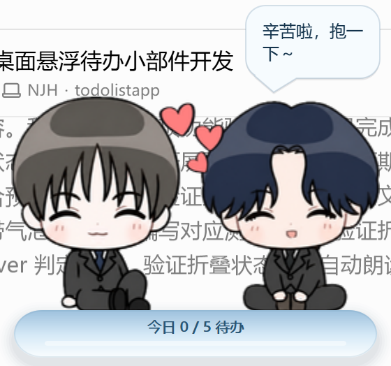
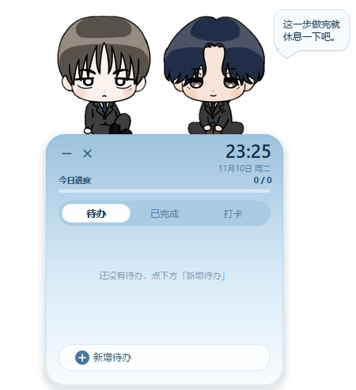

# 家产 · PeekTodo

一个常驻桌面的悬浮待办小部件：**无边框、外部完全透明、始终置顶、可拖动**。两位 Q 版角色坐在卡片上沿探出半个身子，鼠标离开面板就自己缩成「探头」，鼠标贴上去又展开回面板。

> Windows + PyQt5，纯本地运行，数据存本地 JSON，不联网。

| 探头态 | 展开态 |
| --- | --- |
|  |  |

## 特性

- **透明悬浮窗**：`WA_TranslucentBackground` + 分层窗口，窗口外区域完全透明，能看到真实桌面；透明像素点击穿透。
- **角色动效克制**：只有「缓慢上下漂浮（±3px / 5.6s）」和「随机眨眼」，不旋转、不缩放、不抖动。眨眼是把笑颜原图上眼睛周围的小块羽化后贴回，不是拿色块盖住。
- **每 5 秒说一句话**：随机挑一位角色，表情按 平静 → 笑颜 → 糟糕 循环，台词与表情一一对应；气泡停留 3.6s。
- **悬停自动收起/展开**：鼠标离开面板 0.65s 收成探头；光标在探头上停 0.25s 展开。展开后必须先「真正进来过一次」才允许自动收起，避免边界抖动。
- **贴边吸附**：拖到屏幕边缘附近松手，收起时探头会吸附到边上。
- **待办**：新增、双击改字、删除、勾选完成/撤销；「今日进度」与细进度条实时更新。
- **打卡**：多条习惯，每条可按周一到周日独立勾选，当天有腮红描边。
- **单实例**：`QLocalServer` 保证只有一个进程，重复启动会把已有窗口唤到前台。
- **本地持久化**：原子写 + 260ms 去抖，数据在 `data/data.json`，重启不丢。

## 运行

```bat
pip install -r requirements.txt
启动待办小部件.bat
```

`启动待办小部件.bat` 用 `pythonw.exe` 启动，不会弹黑控制台窗口。也可以手动：

```bat
pythonw app\main.py
```

想要桌面快捷方式：

```powershell
powershell -ExecutionPolicy Bypass -File tools\make_shortcut.ps1
```

## 目录

```
app/
  main.py     入口：高 DPI、单实例、异常兜底
  window.py   主窗口：绘制、拖动、收起/展开、气泡、右键菜单
  charview.py 双角色贴图、漂浮、眨眼
  widgets.py  自绘控件：按钮/标签页/任务行/打卡行/气泡
  store.py    JSON 存取、CRUD、进度统计
  theme.py    主题色与尺寸常量
assets/
  pair_*.png  双角色贴图（整块取景，不拆开）
  meta.json   贴图尺寸、眼睛框、不眨眼表情表
  app.ico     图标
平静.PNG / 笑颜.PNG / 糟糕.PNG   原始素材
tools/
  build_assets.py   由三张原图生成 pair_*.png + meta.json + app.ico
  render_preview.py 离屏渲染界面状态，出预览图
```

## 数据

`data/data.json`：

```json
{
  "ui": {"x": 560, "y": 60, "tab": 0},
  "todos": [{"id": "...", "text": "...", "done": false, "created": "..."}],
  "habits": [{"id": "...", "title": "...", "days": {"0": true, "3": true}}]
}
```

项目目录不可写时会回落到 `%APPDATA%\PeekTodo`。

## 说明

- 角色图来自项目里的三张原图，`tools/build_assets.py` 负责裁图、缩放和眼睛框定位；换素材只要替换同名 PNG 并重跑一次脚本。
- 界面全部自绘（`QPainter`），不使用系统原生按钮，也没有粗边框。
